# Use Case Diagram

Mermaid flowchart used as a Use Case Diagram. Actors are rectangles with
rounded corners; use cases are ovals (stadium shape `([...])`). Derived
from `routes/web.php`, all controllers, and role-based access defined in
the router.

```mermaid
flowchart LR
    %% ── Actors ──────────────────────────────────────────────────────────
    BO(["👤 Business Owner"])
    HR(["👤 HR Head"])
    EM(["👤 Employee"])
    SY(["⚙️ System"])

    %% ── Authentication Use Cases ────────────────────────────────────────
    subgraph AUTH["🔐 Authentication"]
        UC_LOGIN(["Login with Email & Password"])
        UC_FORGOT(["Request Password Reset"])
        UC_RESET(["Reset Password via OTP"])
        UC_CHANGE(["Change Password"])
        UC_LOGOUT(["Logout"])
    end

    BO --> UC_LOGIN
    HR --> UC_LOGIN
    EM --> UC_LOGIN
    BO --> UC_FORGOT
    HR --> UC_FORGOT
    EM --> UC_FORGOT
    UC_FORGOT --> UC_RESET
    BO --> UC_CHANGE
    HR --> UC_CHANGE
    EM --> UC_CHANGE
    BO --> UC_LOGOUT
    HR --> UC_LOGOUT
    EM --> UC_LOGOUT

    %% ── Dashboard ────────────────────────────────────────────────────────
    subgraph DASH["📊 Dashboard"]
        UC_ODASH(["View Owner Dashboard"])
        UC_HDASH(["View HR Dashboard"])
        UC_EDASH(["View Employee Dashboard"])
    end

    BO --> UC_ODASH
    HR --> UC_HDASH
    EM --> UC_EDASH

    %% ── User Management ─────────────────────────────────────────────────
    subgraph USERS["👥 User Management"]
        UC_LSTU(["List Users"])
        UC_CRTU(["Create User Account"])
        UC_EDTU(["Edit User Account"])
        UC_TGLU(["Activate / Deactivate User"])
        UC_ARCU(["Archive User"])
        UC_RPWD(["Reset User Password"])
    end

    BO --> UC_LSTU
    HR --> UC_LSTU
    BO --> UC_CRTU
    BO --> UC_EDTU
    HR --> UC_EDTU
    BO --> UC_TGLU
    BO --> UC_ARCU
    BO --> UC_RPWD
    HR --> UC_RPWD

    %% ── Employee Management ─────────────────────────────────────────────
    subgraph EMP["🧑‍💼 Employee Management"]
        UC_LSTE(["List Employees"])
        UC_CRTE(["Create Employee Record"])
        UC_EDTE(["Edit Employee Record"])
        UC_TRNE(["Transfer Employee"])
        UC_ARCE(["Archive Employee"])
        UC_RHRE(["Rehire Employee"])
        UC_BANK(["Manage Bank Details"])
        UC_DOCS(["Upload / Manage Documents"])
        UC_NOTZ(["Issue HR Notice"])
    end

    HR --> UC_LSTE
    HR --> UC_CRTE
    HR --> UC_EDTE
    HR --> UC_TRNE
    HR --> UC_ARCE
    HR --> UC_RHRE
    HR --> UC_BANK
    HR --> UC_DOCS
    HR --> UC_NOTZ

    %% ── Work Schedule ───────────────────────────────────────────────────
    subgraph SCHED["📅 Work Schedules & Holidays"]
        UC_LSCHS(["List Schedules"])
        UC_CRSCH(["Create Schedule"])
        UC_ASSCH(["Assign Schedule to Employee"])
        UC_EDSCH(["Edit Schedule"])
        UC_HOLID(["Manage Holiday Calendar"])
    end

    HR --> UC_LSCHS
    HR --> UC_CRSCH
    HR --> UC_ASSCH
    HR --> UC_EDSCH
    HR --> UC_HOLID

    %% ── Attendance ──────────────────────────────────────────────────────
    subgraph ATTN["📋 Attendance Management"]
        UC_IMPA(["Upload Biometric XLS File"])
        UC_CNFA(["Confirm & Approve Import"])
        UC_ADJA(["Adjust Attendance Entry"])
        UC_FLGA(["Review Policy Flags"])
        UC_LSTA(["List Attendance Records"])
        UC_FREQ(["View Frequency Report"])
    end

    HR --> UC_IMPA
    HR --> UC_CNFA
    HR --> UC_ADJA
    HR --> UC_FLGA
    HR --> UC_LSTA
    HR --> UC_FREQ
    BO --> UC_FREQ

    %% ── Request Management ──────────────────────────────────────────────
    subgraph REQS["📨 Request Management"]
        UC_SUBR(["Submit Leave Request"])
        UC_SUBO(["Submit Overtime Request"])
        UC_SUBC(["Submit Cash Advance Request"])
        UC_CANR(["Cancel Own Request"])
        UC_APRR(["Approve / Cancel Request"])
        UC_LSTR(["List All Requests"])
        UC_LCRD(["Manage Leave Credits"])
        UC_CATR(["View Cash Advance Tracker"])
    end

    EM --> UC_SUBR
    EM --> UC_SUBO
    EM --> UC_SUBC
    EM --> UC_CANR
    HR --> UC_APRR
    BO --> UC_APRR
    HR --> UC_LSTR
    HR --> UC_LCRD
    HR --> UC_CATR
    BO --> UC_CATR

    %% ── Salary Management ───────────────────────────────────────────────
    subgraph SAL["💰 Salary Management"]
        UC_LSALS(["List Salary Structures"])
        UC_CRSAL(["Create Salary Record"])
        UC_EDSAL(["Edit Salary Record"])
        UC_ARSAL(["Archive Salary Record"])
    end

    HR --> UC_LSALS
    HR --> UC_CRSAL
    HR --> UC_EDSAL
    HR --> UC_ARSAL

    %% ── Benefits & Contributions ────────────────────────────────────────
    subgraph BENS["🏦 Benefits & Deductions"]
        UC_LVBEN(["View Contribution Records"])
        UC_POLCY(["View / Approve Contribution Policies"])
        UC_LOCKC(["Lock / Unlock Contribution Record"])
    end

    HR --> UC_LVBEN
    HR --> UC_POLCY
    HR --> UC_LOCKC

    %% ── Payroll Management ──────────────────────────────────────────────
    subgraph PAY["📑 Payroll Management"]
        UC_CRPAY(["Create Payroll Run"])
        UC_CPAY(["Compute Payroll"])
        UC_ADJP(["Adjust Payroll Entry"])
        UC_SUBP(["Submit Payroll for Approval"])
        UC_RVWP(["Review Payroll Run"])
        UC_APOP(["Approve Payroll"])
        UC_RETP(["Return Payroll for Revision"])
        UC_CANP(["Cancel Payroll Run"])
        UC_PRNT(["Print Timesheet"])
        UC_DISB(["View Disbursement Summary"])
        UC_EXPC(["Export Deposit Slip CSV"])
    end

    HR --> UC_CRPAY
    HR --> UC_CPAY
    HR --> UC_ADJP
    HR --> UC_SUBP
    HR --> UC_CANP
    HR --> UC_PRNT
    HR --> UC_DISB
    HR --> UC_EXPC
    BO --> UC_RVWP
    BO --> UC_APOP
    BO --> UC_RETP
    BO --> UC_PRNT
    BO --> UC_DISB
    BO --> UC_EXPC

    %% ── Reports ─────────────────────────────────────────────────────────
    subgraph RPTS["📈 Reports"]
        UC_RPTM(["View / Export Payroll Report"])
        UC_RPT13(["View 13th Month Report"])
        UC_RPTT(["View Transaction Slips"])
        UC_RPTS(["View Payslips Report"])
        UC_RPTB(["Bulk Print Payslips"])
    end

    HR --> UC_RPTM
    HR --> UC_RPT13
    HR --> UC_RPTT
    HR --> UC_RPTS
    HR --> UC_RPTB
    BO --> UC_RPTM
    BO --> UC_RPT13
    BO --> UC_RPTT
    BO --> UC_RPTS
    BO --> UC_RPTB

    %% ── Settings ────────────────────────────────────────────────────────
    subgraph SETS["⚙️ Settings"]
        UC_POSP(["Manage Job Positions"])
        UC_PRDP(["Manage Payroll Periods"])
    end

    HR --> UC_POSP
    HR --> UC_PRDP

    %% ── Employee Self-Service ────────────────────────────────────────────
    subgraph ESS["🙋 Employee Self-Service"]
        UC_VATT(["View Own Attendance"])
        UC_VRQS(["View Own Requests"])
        UC_VPAY(["View Own Payslips"])
        UC_DPAY(["Download Payslip PDF"])
        UC_VNTZ(["View HR Notices"])
        UC_AKNZ(["Acknowledge HR Notice"])
    end

    EM --> UC_VATT
    EM --> UC_VRQS
    EM --> UC_VPAY
    EM --> UC_DPAY
    EM --> UC_VNTZ
    EM --> UC_AKNZ

    %% ── System ──────────────────────────────────────────────────────────
    subgraph SYSA["🤖 System Automated"]
        UC_SEML(["Send Password Reset Email"])
        UC_GSLP(["Generate Payslip PDF"])
        UC_GCON(["Compute Government Contributions"])
        UC_FLGP(["Raise Attendance Policy Flags"])
    end

    SY --> UC_SEML
    SY --> UC_GSLP
    SY --> UC_GCON
    SY --> UC_FLGP
    UC_FORGOT -.->|triggers| UC_SEML
    UC_APOP -.->|triggers| UC_GSLP
    UC_CPAY -.->|triggers| UC_GCON
    UC_CNFA -.->|triggers| UC_FLGP
```

## Notes

- All use cases derived directly from `routes/web.php` route definitions and controller action names.
- Role access constraints enforced by the router's third parameter (roles array) and `AuthMiddleware`.
- The `«extend»` / `«include»` relationships are shown as dashed arrows where one use case triggers another automatically.
- The Business Owner has no `employee` record and is excluded from payroll.
