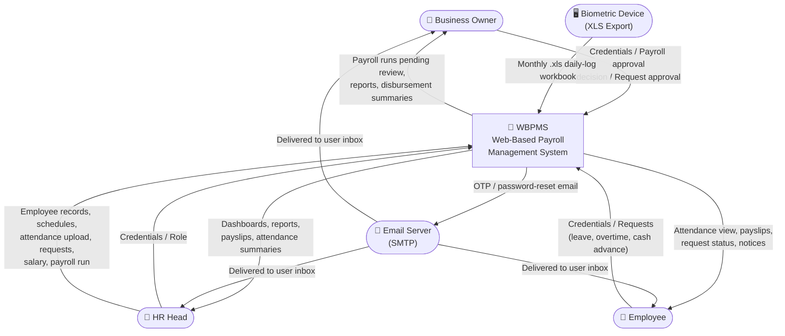

# Data Flow Diagram (DFD)

Derived from the application's service layer, routes, and database schema.
Mermaid flowchart is used since Mermaid has no native DFD syntax.

---

## Level 0 — Context Diagram

Shows the system as a single process with all external actors and high-level data flows.

---

## Level 1 — System Data Flow Diagram

Expands WBPMS into its 12 major functional modules. Data stores are labeled
with their primary table names from the database schema.

```mermaid
flowchart TD
    %% ── External Entities ───────────────────────────────────────────────
    BO(["👤 Business Owner"])
    HR(["👤 HR Head"])
    EM(["👤 Employee"])
    BIO(["🖥️ Biometric XLS"])
    SMTP(["📧 SMTP Server"])

    %% ── Data Stores ─────────────────────────────────────────────────────
    DS1[("D1: users\nrole\nsessions")]
    DS2[("D2: employee\nbranch\naddress")]
    DS3[("D3: work_schedule\nholiday_calendar")]
    DS4[("D4: attendance_import_batch\nbiometric_punch\nattendance")]
    DS5[("D5: request\nleave_entitlement\nleave_ledger\ncash_advance_history")]
    DS6[("D6: salary\npayroll_policy_version")]
    DS7[("D7: contribution_policy_version\nsss_bracket\nphilhealth_rate\npagibig_rate")]
    DS8[("D8: payroll_run\npayroll\npayroll_earnings\ndeduction\npayslip")]
    DS9[("D9: bank_details\ndisbursement_batch\ndeposit_slip")]
    DS10[("D10: audit_logs\npassword_reset_challenge")]
    DS11[("D11: employee_document\nemployee_hr_notice")]

    %% ── Processes ────────────────────────────────────────────────────────
    P1["P1\nAuthentication\n& Session"]
    P2["P2\nUser\nManagement"]
    P3["P3\nEmployee\nManagement"]
    P4["P4\nWork Schedule\nManagement"]
    P5["P5\nAttendance\nImport & Management"]
    P6["P6\nRequest\nManagement"]
    P7["P7\nSalary\nManagement"]
    P8["P8\nContribution\nEngine"]
    P9["P9\nPayroll\nComputation\n& Approval"]
    P10["P10\nReport\nGeneration"]
    P11["P11\nEmployee\nSelf-Service"]
    P12["P12\nDisbursement\nManagement"]

    %% ── P1: Authentication ──────────────────────────────────────────────
    BO -- "email + password" --> P1
    HR -- "email + password" --> P1
    EM -- "email + password" --> P1
    P1 -- "session token" --> BO
    P1 -- "session token" --> HR
    P1 -- "session token" --> EM
    P1 -- "OTP email request" --> SMTP
    P1 <--> DS1
    P1 --> DS10

    %% ── P2: User Management ─────────────────────────────────────────────
    BO -- "create/edit/archive user" --> P2
    HR -- "edit Employee user" --> P2
    P2 <--> DS1
    P2 --> DS10

    %% ── P3: Employee Management ─────────────────────────────────────────
    HR -- "employee data, transfer, archive, rehire" --> P3
    P3 <--> DS2
    P3 --> DS11
    P3 --> DS10

    %% ── P4: Work Schedules ──────────────────────────────────────────────
    HR -- "schedule data, holidays" --> P4
    P4 <--> DS3
    P4 --> DS10

    %% ── P5: Attendance ──────────────────────────────────────────────────
    BIO -- ".xls workbook" --> P5
    HR -- "import trigger, adjustments" --> P5
    P5 <--> DS4
    P5 -- "reads schedule" --> DS3
    P5 -- "reads enrollment" --> DS2
    P5 --> DS10

    %% ── P6: Requests ────────────────────────────────────────────────────
    EM -- "submit request" --> P6
    HR -- "approve/cancel request" --> P6
    BO -- "approve/cancel request" --> P6
    P6 <--> DS5
    P6 -- "reads employee" --> DS2
    P6 --> DS10

    %% ── P7: Salary ──────────────────────────────────────────────────────
    HR -- "salary record" --> P7
    P7 <--> DS6
    P7 --> DS10

    %% ── P8: Contribution Engine ─────────────────────────────────────────
    P8 -- "reads policy" --> DS7
    P8 -- "reads salary" --> DS6
    P8 -- "contribution records" --> DS8

    %% ── P9: Payroll ─────────────────────────────────────────────────────
    HR -- "generate/compute/submit run" --> P9
    BO -- "approve/return run" --> P9
    P9 -- "reads attendance" --> DS4
    P9 -- "reads requests" --> DS5
    P9 -- "reads salary" --> DS6
    P9 --> P8
    P9 <--> DS8
    P9 --> DS10

    %% ── P10: Reports ────────────────────────────────────────────────────
    HR -- "report request" --> P10
    BO -- "report request" --> P10
    P10 -- "reads payroll" --> DS8
    P10 -- "reads attendance" --> DS4
    P10 -- "reads requests" --> DS5
    P10 -- "reads contributions" --> DS7
    P10 -- "report output" --> HR
    P10 -- "report output" --> BO

    %% ── P11: Employee Self-Service ──────────────────────────────────────
    EM -- "view attendance, payslips, requests" --> P11
    P11 -- "reads attendance" --> DS4
    P11 -- "reads payslip" --> DS8
    P11 -- "reads requests" --> DS5
    P11 -- "reads notices" --> DS11
    P11 -- "attendance data, payslip, status" --> EM

    %% ── P12: Disbursement ───────────────────────────────────────────────
    HR -- "prepare deposit list" --> P12
    P12 -- "reads payroll" --> DS8
    P12 -- "reads bank details" --> DS9
    P12 <--> DS9
    P12 -- "disbursement list" --> HR
    P12 -- "disbursement summary" --> BO
```

## Notes

- P5 (Attendance) uses the `LdeXlsDailyLogParser` to decode the biometric `.xls` BIFF
  workbook. Matching of `device_employee_code` to `employee_id` is done via
  `employee_biometric_enrollment`.
- P8 (Contribution Engine) only runs on the last-Friday payroll per ADR-0001.
- P9 triggers P8 automatically during `compute` — not a separate user action.
- Audit trail (D10) receives writes from nearly every process; only the main flows are shown.
