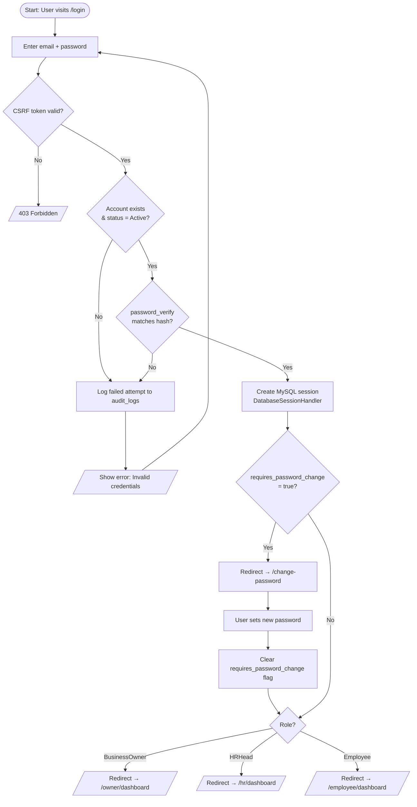
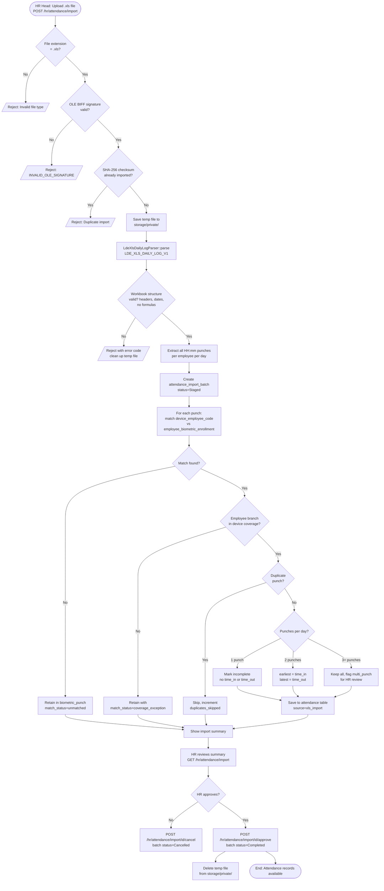
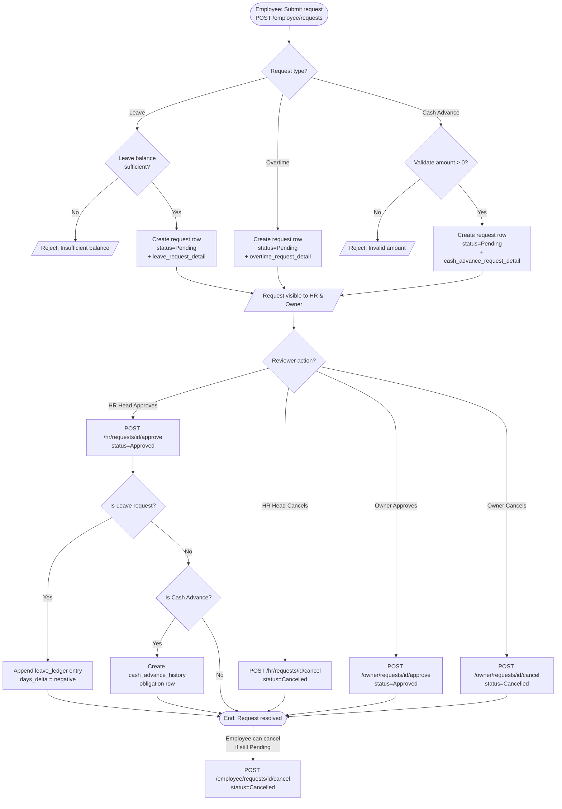
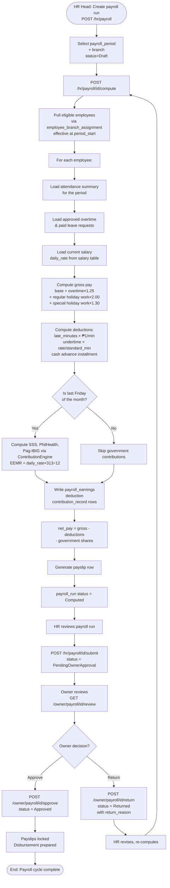
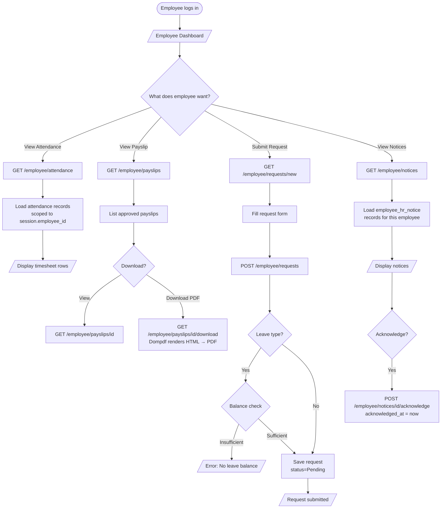

# System Flowchart

Covers the five core operational workflows of WBPMS. Derived from
controller actions, service method logic, and route definitions.

---

## 1. Login & Authentication Flow

---

## 2. Attendance Import Flow

---

## 3. Request Submission & Approval Flow

---

## 4. Payroll Computation & Approval Flow

---

## 5. Employee Self-Service Flow

## Notes

- All flow decisions derived from actual controller method logic and service validation rules.
- The payroll state machine `Draft → Computed → PendingOwnerApproval → Approved / Returned` is enforced by `payroll_run.status` in `PayrollService`.
- The attendance import transactional rollback is enforced by `AttendanceImportGateway::transactional()`.
- Government contributions only apply on the last-Friday payroll per `ContributionEngine::isContributionDeductionRun()`.
