# Activity Diagram — Payroll Lifecycle

Models the full payroll lifecycle as a UML-style activity diagram using
Mermaid flowchart with swimlanes. Derived from `PayrollService.php`,
`routes/web.php`, and the `payroll_run` state machine in the migrations.

**State machine:** `Draft → Computed → PendingOwnerApproval → Approved (final)`
or `PendingOwnerApproval → Returned → Computed (revise)`

```mermaid
flowchart TD
    START([● Start of Payroll Week])

    %% ── SWIMLANE: HR Head ───────────────────────────────────────────────
    subgraph HR["🧑‍💼 HR Head"]
        HR1["Define payroll period\n(Sunday start → Friday end)\nPOST /hr/settings/periods"]
        HR2["Create payroll run\nSelect branch + period\nPOST /hr/payroll"]
        HR3["Trigger compute\nPOST /hr/payroll/{id}/compute"]
        HR4["Review computation results\nGET /hr/payroll/{id}"]
        HR5{Satisfied\nwith results?}
        HR6["Adjust individual entries\nPOST /hr/payroll/{id}/employees/{payrollId}/adjust"]
        HR7["Submit for Owner approval\nPOST /hr/payroll/{id}/submit"]
        HR8{Owner\nreturned?}
        HR9["Revise payroll\n(re-compute or adjust)"]
        HR10["Prepare disbursement list\nGET /payroll/{id}/disbursement-summary"]
        HR11["Export deposit slip CSV\nGET /payroll/{id}/disbursement-summary/export"]
        HR12["Bulk print payslips\nGET /hr/reports/payslips/bulk"]
    end

    %% ── SWIMLANE: System ────────────────────────────────────────────────
    subgraph SYS["⚙️ System (PayrollService)"]
        SYS1["Load eligible employees\nvia employee_branch_assignment\neffective at period_start"]
        SYS2["For each employee:\nLoad attendance summary\n(late_minutes, overtime_minutes,\nhours_worked_minutes)"]
        SYS3["Load approved overtime\n& paid leave requests\nfor the period"]
        SYS4["Load current salary record\n(effective daily_rate)"]
        SYS5["Compute gross pay\n• base_days × daily_rate\n• overtime × 1.25×\n• regular holiday × 2.00×\n• special holiday × 1.30×\n• approved paid leave"]
        SYS6["Compute deductions\n• late: minutes × ₱1.00/min\n• undertime: min × rate/standard\n• cash advance installment"]
        SYS7{Last Friday\nof the month?}
        SYS8["Run ContributionEngine\nEEMR = daily_rate × 313 ÷ 12\nSSS bracket lookup\nPhilHealth rate\nPag-IBIG fixed amount"]
        SYS9["Skip government\ncontributions"]
        SYS10["Write rows:\npayroll_earnings\ndeduction\ncontribution_record"]
        SYS11["Calculate net_pay\ngross - deductions - gov shares"]
        SYS12["Generate payslip row\nwith content_hash"]
        SYS13["payroll_run.status = Computed"]
        SYS14["payroll_run.status =\nPendingOwnerApproval"]
        SYS15["payroll_run.status = Returned"]
        SYS16["payroll_run.status = Approved\n(immutable — no further edits)"]
        SYS17["Payslips locked\nPDFs available for download"]
        SYS18["Raise attendance_policy_flags\nif applicable"]
    end

    %% ── SWIMLANE: Business Owner ────────────────────────────────────────
    subgraph OWN["👔 Business Owner"]
        OWN1["Review payroll run\nGET /owner/payroll/{id}/review\nView timesheet + disbursement summary"]
        OWN2{Decision?}
        OWN3["Approve\nPOST /owner/payroll/{id}/approve"]
        OWN4["Return for revision\nPOST /owner/payroll/{id}/return\n(return_reason required)"]
    end

    %% ── SWIMLANE: Employee ──────────────────────────────────────────────
    subgraph EMP["🙋 Employee"]
        EMP1["View payslip\nGET /employee/payslips/{id}"]
        EMP2["Download PDF\nGET /employee/payslips/{id}/download"]
    end

    %% ── FLOW ────────────────────────────────────────────────────────────
    START --> HR1
    HR1 --> HR2
    HR2 --> SYS1
    SYS1 --> HR3
    HR3 --> SYS2
    SYS2 --> SYS3
    SYS3 --> SYS4
    SYS4 --> SYS5
    SYS5 --> SYS6
    SYS6 --> SYS7
    SYS7 -- Yes --> SYS8
    SYS7 -- No --> SYS9
    SYS8 --> SYS10
    SYS9 --> SYS10
    SYS10 --> SYS11
    SYS11 --> SYS12
    SYS12 --> SYS13
    SYS13 --> SYS18
    SYS18 --> HR4
    HR4 --> HR5
    HR5 -- No --> HR6
    HR6 --> HR3
    HR5 -- Yes --> HR7
    HR7 --> SYS14
    SYS14 --> OWN1
    OWN1 --> OWN2
    OWN2 -- Approve --> OWN3
    OWN2 -- Return --> OWN4
    OWN4 --> SYS15
    SYS15 --> HR8
    HR8 -- Yes --> HR9
    HR9 --> HR3
    OWN3 --> SYS16
    SYS16 --> SYS17
    SYS17 --> HR10
    HR10 --> HR11
    HR11 --> HR12
    HR12 --> EMP1
    EMP1 --> EMP2
    EMP2 --> FINISH

    FINISH([● End: Payroll Cycle Complete])
```

## Payroll State Transition Summary

| From State | Action | By | To State |
|---|---|---|---|
| (none) | Create run | HR Head | `Draft` |
| `Draft` | compute | HR Head | `Computed` |
| `Computed` | submit | HR Head | `PendingOwnerApproval` |
| `PendingOwnerApproval` | approve | Business Owner | `Approved` (final) |
| `PendingOwnerApproval` | return | Business Owner | `Returned` |
| `Returned` | re-compute | HR Head | `Computed` |
| `Draft`/`Computed` | cancel | HR Head | `Cancelled` |

## Computation Rules (from `PayrollService.php`)

| Earning Type | Multiplier |
|---|---|
| Regular day worked | 1.00× daily rate |
| Approved overtime | 1.25× hourly rate |
| Regular holiday work | 2.00× daily rate |
| Special non-working holiday | 1.30× daily rate |
| Approved paid leave | 1.00× daily rate |

| Deduction Type | Formula |
|---|---|
| Lateness | `late_minutes × ₱1.00 per minute` |
| Undertime | `undertime_min × (daily_rate ÷ standard_min)` |
| Cash advance | Installment from `cash_advance_repayment` |
| SSS | Bracket lookup via `sss_bracket` (last-Friday only) |
| PhilHealth | `EEMR × rate_decimal ÷ 2` (last-Friday only) |
| Pag-IBIG | Fixed employee share (last-Friday only) |

**EEMR formula:** `(daily_rate × 313) ÷ 12`
