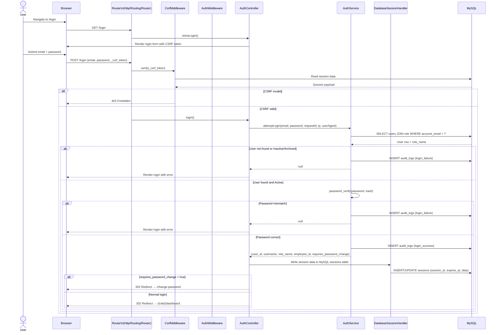
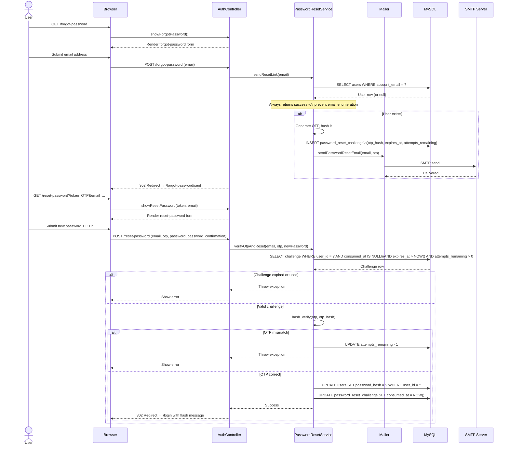
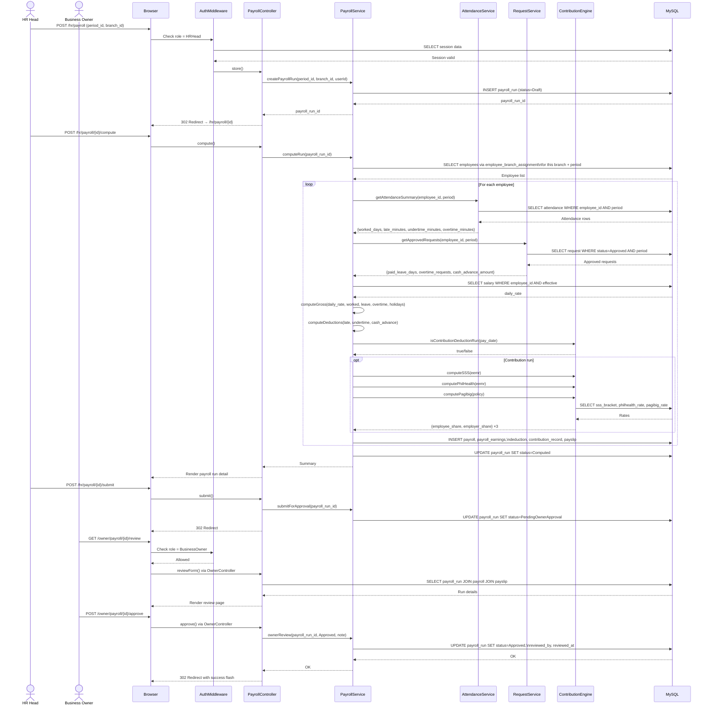
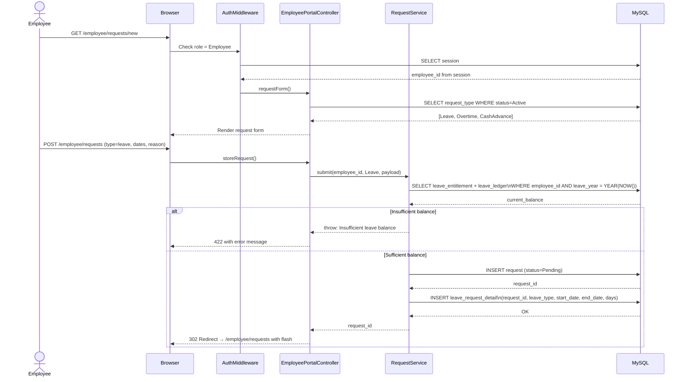

# Sequence Diagrams

Derived from `AuthService.php`, `PayrollService.php`, `routes/web.php`,
controller action implementations, and the session/middleware stack.

---

## Sequence 1 — User Login

---

## Sequence 2 — Password Reset (Forgot Password)

---

## Sequence 3 — Payroll Run Submission & Owner Approval

---

## Sequence 4 — Employee Submits Leave Request

## Notes

- `AuthMiddleware` intercepts every protected route before the controller runs.
- `CsrfMiddleware` intercepts all POST/PUT/DELETE requests before `AuthMiddleware`.
- The `DatabaseSessionHandler` implements PHP's `SessionHandlerInterface` and stores sessions in MySQL `sessions` table with `expires_at` Unix timestamp.
- `PasswordResetService` never reveals whether an email exists (always redirects to `/forgot-password/sent`).
- All DB writes in `PayrollService::computeRun()` happen inside a single PDO transaction; any exception triggers a full rollback.
